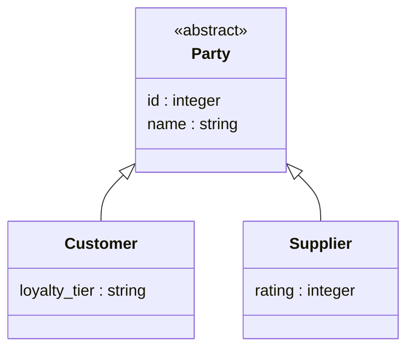
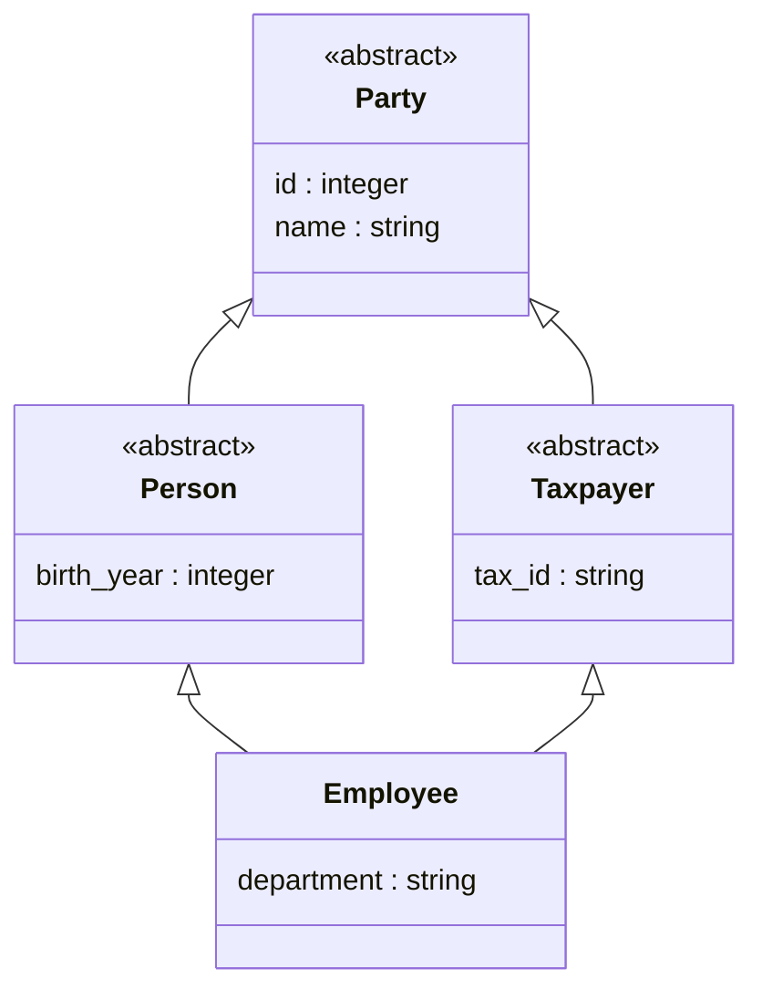
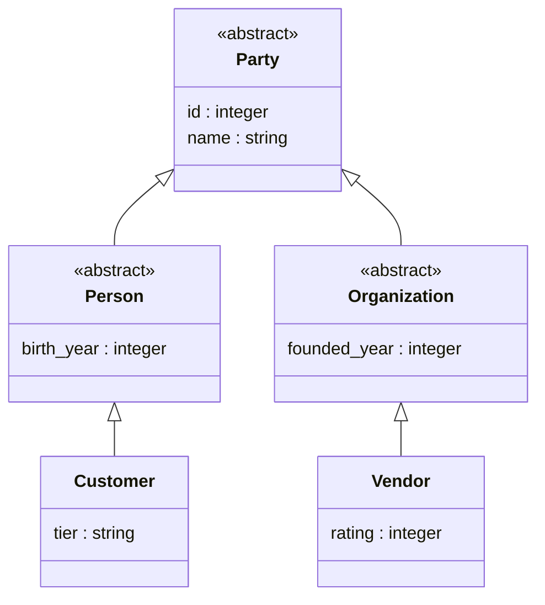

# Modeling class hierarchies

When several entities are kinds of one thing — a customer and a supplier are both
parties you deal with — you can declare the general kind once and say that each
specific kind `extends` it. A query written against the general kind then reaches
every specific kind. `extends` is the semantic model's *is-a*: a customer is a
party.

`kcmd push` expresses the hierarchy on the graph as **labels**. A subtype's node
table carries its own label plus one label per supertype, so `MATCH (:Party)`
matches every customer and every supplier. The exact generation rules — how
fields flatten down, what a label signature must contain — are in
[Reference → Class hierarchies](reference.md#class-hierarchies-extends--labels);
this page is the modeling guide.

## When to use it

Use `extends` when the shared fields reflect a real *is a kind of* relationship
and you want a supertype query to gather every subtype.

Do not use it when the shared fields are a coincidence of naming, or when you
have one entity whose columns happen to be split across two tables — that is a
[binding](profiles.md), and modeling it as inheritance produces the double-count
described below.

## The one rule

A supertype query gathers every subtype. Because it gathers subtypes, **each real
thing must live in exactly one place**, or it is gathered more than once and your
counts double. State it once and rely on it:

> **One real thing, one row, one node.**

Everything below is a way to honor this rule.

## 1. Declare the hierarchy

`Party` is the general kind. In this model no row is *just* a party — every party
is a customer or a supplier — so `Party` has no table of its own. Mark it
`abstract: true`: it has no `source`, no key and no column bindings, produces no
node table, and survives in the graph only as a label on its subtypes.

Each concrete kind declares its own fields and the one `extends` keyword. The
supertype's fields are inherited, so you do not repeat them:

```yaml
version: "0.2.0.dev0/google"
semantic_model:
  - name: parties
    entities:
      - name: Party
        abstract: true
        fields:
          - { name: id,   datatype: Integer }
          - { name: name, datatype: String }
      - name: Customer
        extends: [Party]
        primary_key: [id]          # each subtype keeps its OWN key; keys are not inherited
        fields:
          - { name: loyalty_tier, datatype: String }
      - name: Supplier
        extends: [Party]
        primary_key: [id]
        fields:
          - { name: rating, datatype: Integer }
```

The supertype's `id` and `name` flatten down onto both subtypes, so `Customer`
and `Supplier` each expose them, and each subtype node carries both its own label
and the `Party` label.



`Party` is abstract, so it has no table of its own; the arrows are `extends`. A
query against `Party` reaches every subtype below it.

## 2. Bind each subtype's table

Inheritance meets binding at one requirement: **each subtype's table must expose
the inherited columns**, because those fields are read from the subtype's own
table. `Party.name`, flattened onto `Customer`, is read from the customer table,
so that table must have a name column.

A binding gives each entity its `source` and each field its column. With one
store you can bind inline on the model as the `default` profile:

```yaml
      - name: Customer
        extends: [Party]
        primary_key: [id]
        source: my-project.sales.customer
        fields:
          - { name: id,           expression: c_custkey }
          - { name: name,         expression: c_name }   # the inherited field, bound here
          - { name: loyalty_tier, datatype: String, expression: c_tier }
```

A redeclared inherited field carries only its binding. Its datatype and the rest
of its definition come from `Party`, and push rejects a redeclaration that
restates them.

To bind the same hierarchy to more than one store, put each binding in its own
[profile](profiles.md). A named profile binds every concrete subtype, since
each one stands for a table the profile's database has to hold. A profile can
bind a field the
subtype inherits by naming it under that subtype, with no redeclaration in the
model file, and the binding reads from the subtype's own table.

## 3. Query the supertype

```
GRAPH my-project.sales.parties
MATCH (p:Party)
RETURN p.name
```

Every customer and every supplier comes back, each once, because each real party
lives in exactly one table.

## More hierarchy shapes

`extends` composes. A subtype can extend several supertypes, and a supertype can
extend another supertype above it. Two facts hold for every shape: the supertype
fields flatten down, and each concrete table binds every inherited field to its
own column. So the shapes below all deploy the same way, and each was verified to
deploy on BigQuery Graph.

### Extending more than one supertype, and diamonds

`extends` takes a list. Here an `Employee` is both a `Person` and a `Taxpayer`,
and each of those is a `Party`:

```yaml
      - name: Party
        abstract: true
        fields:
          - { name: id,   datatype: Integer }
          - { name: name, datatype: String }
      - name: Person
        abstract: true
        extends: [Party]
        fields:
          - { name: birth_year, datatype: Integer }
      - name: Taxpayer
        abstract: true
        extends: [Party]
        fields:
          - { name: tax_id, datatype: String }
      - name: Employee
        extends: [Person, Taxpayer]
        primary_key: [id]
        source: my-project.hr.employee
        fields:
          - { name: id,         expression: e_id }
          - { name: name,       expression: e_name }
          - { name: birth_year, expression: e_birth }
          - { name: tax_id,     expression: e_tax }
          - { name: department, datatype: String, expression: e_dept }
```



`Party` sits at the top and is reached through two paths, so this is a diamond.
`Employee` carries the `Person`, `Taxpayer`, and `Party` labels, and `Party`
appears once. `MATCH (:Person)`, `MATCH (:Taxpayer)`, and `MATCH (:Party)` each
return every employee a single time. The number of supertypes a subtype has, and
the number of paths that reach a shared ancestor, do not change the count.

A field may be declared on only one side of a diamond. If `Person` and
`Taxpayer` both declared a `nickname` field, push would reject the model,
because neither is nearer to `Employee` and nothing says which one wins. Declare
a field both sides share on `Party` instead. The same holds for a binding: two
concrete supertypes that each rebind a field they inherit from `Party` leave
their common subtype ambiguous, and push rejects it.

### Deeper hierarchies

A hierarchy can run several levels deep with a concrete table at each leaf. Here
`Party` divides into `Person` and `Organization`, and each has its own concrete
kind: a `Customer` is a person, a `Vendor` is an organization:

```yaml
      - name: Party
        abstract: true
        fields:
          - { name: id,   datatype: Integer }
          - { name: name, datatype: String }
      - name: Person
        abstract: true
        extends: [Party]
        fields:
          - { name: birth_year, datatype: Integer }
      - name: Organization
        abstract: true
        extends: [Party]
        fields:
          - { name: founded_year, datatype: Integer }
      - name: Customer
        extends: [Person]
        primary_key: [id]
        source: my-project.sales.customer
        fields:
          - { name: id,         expression: c_id }
          - { name: name,       expression: c_name }
          - { name: birth_year, expression: c_birth }
          - { name: tier,       datatype: String, expression: c_tier }
      - name: Vendor
        extends: [Organization]
        primary_key: [id]
        source: my-project.sales.vendor
        fields:
          - { name: id,           expression: v_id }
          - { name: name,         expression: v_name }
          - { name: founded_year, expression: v_founded }
          - { name: rating,       datatype: Integer, expression: v_rating }
```



`Customer` and `Vendor` are the only tables. `MATCH (:Party)` returns every
customer and every vendor; `MATCH (:Person)` returns customers alone, and
`MATCH (:Organization)` vendors alone. Each real party lives in one table, so
every count is exact.

### What keeps every shape correct

These shapes deploy because their supertypes are abstract. Each concrete table
binds every inherited field to its own column, and BigQuery matches a shared
label by property name, so the subtype tables never have to agree on a physical
column. A supertype with its own table works too. Then every subtype table must
carry that supertype's columns under the same names, and a thing present in both
the supertype table and a subtype table is counted twice under the supertype
label. Such a supertype still cannot be a relationship endpoint or own a metric,
because table-backed subtypes extend it. Keeping supertypes abstract keeps the one rule
— one real thing, one node — automatic.

## Match the shape to how your data is stored

How your subtypes are already stored decides how you model them. `extends` builds
one shape directly, and the other two common layouts are modeled without it:

- **One table per kind, the parent has none.** Each concrete kind has its own
  complete table; the supertype has no table and survives as a label; a supertype
  query is the union of the kind tables. This is the shape `extends` builds — the
  hierarchy above. It is correct as long as the kind tables hold disjoint things,
  which is why the parent is `abstract`.
- **One table for the whole family, with a kind column.** All parties in one
  table, a `type` column saying which kind each row is. Model this as one entity
  with a dimension field; it holds one row per thing, so it cannot double-count.
- **A base table plus an extension table.** A thing's general fields in one table
  and its specific fields in another, tied by a shared key. Model this as one
  entity whose binding joins the two tables, so the thing keeps one identity.

## When a supertype total looks too high

If a supertype count or sum comes back larger than the data warrants, the same
real thing lives in more than one table under the hierarchy. Every table carrying
the label contributes that thing as its own node. Take three people split across
a `person` table and a `customer` table that both carry the `Person` label, with
two of the three present in both. `MATCH (:Person)` returns **five** nodes,
because no identity link across the two tables tells the graph that the shared
rows are the same person.

The fix is the one rule. Make the parent `abstract` so no real thing lives in more
than one table under the hierarchy. When the two tables are instead the general
and specific halves of one thing, model them as one entity whose binding joins
them by key.

## Relationships and metrics belong on the leaves

A relationship may connect only concrete leaf entities. A leaf is an entity
that is not abstract and that no table-backed entity extends. An edge stays on
the node table it is declared on. An abstract `Party` has no table, and a concrete
supertype's table holds only its own rows, so an edge declared on a supertype
misses every subtype row. Declare the edge from each leaf that has it instead,
for example from `Customer`. A metric may belong only to a leaf as well, because
a measure cannot sit on a label that several tables share. Push rejects a
relationship or metric on any other entity, including a push to Knowledge
Catalog alone.

Two exemptions follow from the reason for the rule. An abstract subtype and a
[defined entity](#defined-entities-a-subtype-picked-out-by-a-condition) have no
table of their own, so a parent they extend is still a leaf. An [abstract
relationship](#relationship-inheritance) deploys no edge table, only a label
its sub-relationships carry, so its ends may be abstract entities or
supertypes.

## The rules push enforces

Fields flow down to subtypes. Relationships and keys stay where they are
declared. Every table under a shared supertype exposes the identical field set,
so a subtype's table must have a column for every inherited field, or the deploy
fails. Push also rejects a model that breaks any of these rules:

- A subtype redeclares an inherited field only to bind it to a column. A
  redeclaration with nothing but the name is rejected.
- An abstract entity declares no `source`, no keys and no field expressions.
- Relationships and metrics attach only to concrete leaf entities (an abstract
  relationship, which deploys no edge table, is exempt).
- No field is declared or rebound by two supertypes that do not extend each
  other.
- `extends` forms no cycle.

Each rule and its reason is in
[Reference → Class hierarchies](reference.md#class-hierarchies-extends--labels).

Inheritance deploys the same way to BigQuery Graph and Spanner Graph — the extra
labels and the flattened fields are identical on both backends. On Spanner the
model carries no measures, as it does for any model.

## Defined entities: a subtype picked out by a condition

Some subtypes are not stored anywhere on their own. A won opportunity is a row of
the opportunity table whose stage is `5_won`; in OWL it is a *defined class*,
`WonOpportunity ≡ Opportunity ⊓ (salesStage = '5_won')`. Declare it as a
**defined entity**: one parent, a membership condition, and nothing else.

```yaml
version: "0.2.0.dev0/google"
semantic_model:
  - name: sales
    entities:
      - name: Opportunity
        source: bigquery:proj.sales.opportunity
        primary_key: [id]
        fields:
          - name: id
            expression: {dialects: [{dialect: ANSI_SQL, expression: id}]}
          - name: salesStage
            expression: {dialects: [{dialect: ANSI_SQL, expression: sales_stage}]}
          - name: totalContractValue
            expression: {dialects: [{dialect: ANSI_SQL, expression: tcv}]}
      - name: WonOpportunity
        description: An opportunity in the Won stage.
        extends: [Opportunity]
        defined: "salesStage = '5_won'"
      - name: HighValueOpportunity
        extends: [Opportunity]
        defined:
          expression: totalContractValue >= 1000
          description: USD thousands, so at least USD 1M.   # optional note
      - name: MegaDeal
        extends: [HighValueOpportunity]   # a defined entity may refine another
        defined: totalContractValue >= 20000
```

`defined` is a `/google` extension. It takes a bare string or `{expression,
description?}`. The expression is a boolean SQL expression (BigQuery dialect)
over the **field names** of the entity's lineage, not over columns. It may
qualify a name with the entity itself or an ancestor (`MegaDeal.totalContractValue`).
It reads one row, so it cannot reach another entity. A defined entity:

- **extends exactly one parent.** The parent may itself be defined. The nearest
  non-defined ancestor is its **base**, the entity whose rows it selects.
  Membership is the conjunction of every definition up to the base: MegaDeal is
  `(totalContractValue >= 1000) AND (totalContractValue >= 20000)` over
  Opportunity.
- **has no `source`, `primary_key`, `unique_keys` or fields of its own.** It
  shares its base's rows, identity and fields. The loader rejects a source or
  key. `abstract: true` is redundant and is ignored with a warning.
- **cannot be a supertype.** A table-backed entity may not extend a defined one.
  Extend its base instead.
- **leaves its base a leaf.** It forms no node table of its own, so its base is
  still a concrete leaf for the rule that relationships and metrics attach only
  to leaves (see [Relationships and metrics belong on the
  leaves](#relationships-and-metrics-belong-on-the-leaves)).

**On a graph push** (BigQuery and Spanner) a defined entity forms no node table
and no label. It becomes a boolean property `is<Name>` on its base, computed
from the base's own bindings and made two-valued:

```sql
COALESCE(sales_stage = '5_won', FALSE) AS isWonOpportunity
```

So `MATCH (o:Opportunity) WHERE o.isWonOpportunity` answers "won
opportunities". The property's description states the condition. On an
abstract base each concrete descendant binds the property from its own columns.
A descendant that does not bind a referenced field gets `CAST(NULL AS BOOL)`,
with a warning. A relationship endpoint on a defined entity is re-pointed at its
base, and a metric attached to one is dropped (a MEASURE cannot filter rows),
both with a warning.

**Push validation** rejects:

- a missing, multiple or unknown parent, or a parent cycle;
- a source, keys or fields on a defined entity;
- a reference to a field the base does not have (with a hint for a case
  mismatch), or to another entity;
- a table-backed entity that extends a defined one;
- an `is<Name>` that collides with a field of the base or its descendants, or
  with another defined entity's property.

**Knowledge Catalog** publishes a defined entity as a semantic-entity entry like
an abstract one: no source resources and no key. Its definition rides the entry
description as fixed trailing paragraphs (`Definition note: …` when there is a
note, then `Defined as: <expression>`), after `Specializes: <parent>.`. Pull
peels them back off, so push → pull → push is a fixed point.

OWL import compiles `owl:equivalentClass` definitions into defined entities; see
[OWL import → Defined classes](owl-import.md#defined-classes-owlequivalentclass).

## Relationship inheritance

Relationships have a hierarchy of their own, separate from the entity one. A
general relationship names what several specific edges have in common, so one
query reaches all of them. `hasCounterparty` links a commercial document to the
organization on its other side. Both of its ends are abstract categories:
`Opportunity` and `Invoice` extend `CommercialDocument`, and `Client` extends
`Organization`. On an opportunity the counterparty is the client buying, and on
an invoice it is the client paying:

```yaml
relationships:
  - name: hasCounterparty
    from: CommercialDocument    # an abstract entity
    to: Organization            # an abstract entity
    abstract: true              # a label over its sub-relationships, not an edge
  - name: hasBuyer
    from: Opportunity
    to: Client
    extends: [hasCounterparty]
    from_columns: [buyer_id]
    to_columns: [client_id]
  - name: hasPayer
    from: Invoice
    to: Client
    extends: [hasCounterparty]
    from_columns: [payer_id]
    to_columns: [client_id]
```

Both keys are `/google` extensions (`version: …/google`):

- **`extends: [RelName, …]`** — the parents this relationship specializes. On a
  graph push each concrete edge table keeps its own `DEFAULT LABEL` (and
  description) and also carries `LABEL <parent> NO PROPERTIES` for every
  ancestor, nearest first. `MATCH (d)-[:hasCounterparty]->(o)` then spans the
  `hasBuyer` and `hasPayer` edge tables. The labels carry no properties, so
  edge tables over different sources never have to agree on columns.
- **`abstract: true`** — the relationship is only a label. It keeps `from`/`to`,
  which document what it connects, but takes no `from_columns`/`to_columns` and
  deploys no edge table. Because it binds no join, its ends may be abstract
  entities: a relationship between categories, like `hasCounterparty`, is
  written this way. An abstract relationship nothing extends is warned (it
  would reach no edges).

The same one rule applies as for entities. A sub-relationship's `from` and `to`
should be its parent's ends or subtypes of them; the loader warns otherwise. A
concrete relationship connects only concrete leaf entities (see [Relationships
and metrics belong on the leaves](#relationships-and-metrics-belong-on-the-leaves)),
so push rejects one with an abstract end: make it abstract, or declare it
between the leaves, as `hasBuyer` and `hasPayer` are. OWL import makes an object
property with an abstract class at either end an abstract relationship for this
reason (see [OWL import → Abstract
classes](owl-import.md#abstract-classes-by-structure-kcmdabstract)). Keep the
parent abstract. A *concrete* parent between leaves works too — it deploys as an
edge table whose `DEFAULT LABEL` carries `NO PROPERTIES`, with its description
dropped with a warning — but an edge present both in its table and in a child's
table then counts twice under the parent label.

Knowledge Catalog publishes each concrete relationship as usual and appends a
`Specializes: hasCounterparty.` line to its join description; an abstract
relationship publishes no link. See [Reference → Relationship
hierarchies](reference.md#relationship-hierarchies) for every rule, and [OWL
import](owl-import.md#property-hierarchies-rdfssubpropertyof) for how
`rdfs:subPropertyOf` maps onto it.
